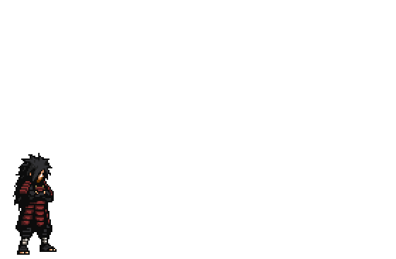

 
<i>— Madara Uchiha</i>

 

  
  
  
  

<h3 align="center">🔥 Arsenal</h3>

  

<h3 align="center">🐍 Atividade</h3>

  <picture>
    <source media="(prefers-color-scheme: dark)" srcset="https://raw.githubusercontent.com/guizorx1/guizorx1/output/snake-dark.svg">
    <source media="(prefers-color-scheme: light)" srcset="https://raw.githubusercontent.com/guizorx1/guizorx1/output/snake.svg">
    
  </picture>

  

Pixel art original publicada no DeviantArt; fundo removido para o perfil.

